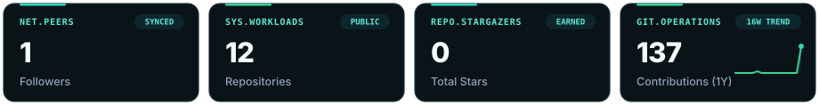

  <picture>
    <source media="(prefers-color-scheme: dark)" srcset="./assets/hud-banner-dark.svg" />
    <source media="(prefers-color-scheme: light)" srcset="./assets/hud-banner-light.svg" />
    
  </picture>

   

  

    
    
    
    
    
  

  <picture>
    <source media="(prefers-color-scheme: dark)" srcset="./assets/telemetry-dark.svg" />
    <source media="(prefers-color-scheme: light)" srcset="./assets/telemetry-light.svg" />
    
  </picture>

---

### `$ cat /etc/motd`

I'm **Imran Jinnah**, a student based in **Sri Lanka** exploring **Linux system administration, containerization, and DevOps engineering**.

My workflow follows a deliberate loop—**`read → learn → understand → commit`**. Rather than memorizing commands in isolation, I approach systems intuitively: breaking down how Linux internals, container runtimes, and Kubernetes clusters behave under the hood, documenting field notes along the way, and shipping practical utilities.

---

### `$ ls -la /opt/toolchain`

| Layer | Technologies & Focus |
| :--- | :--- |
| **Systems & OS** |    |
| **Containers & Cloud Native** |    |
| **Languages & Core** |   |
| **Workflow & Ops** |   |

---

### `$ kubectl get workloads -n uvxv`

| Workload | Focus | Summary |
| :--- | :--- | :--- |
| **[KubeShoot](https://github.com/uvxv/KubeShoot)** | `Kubernetes` · `Diagnostics` | Interactive Kubernetes troubleshooting companion & live cluster reference ([kubeshoot.vercel.app](https://kubeshoot.vercel.app)). |
| **[RHCSA-Notes](https://github.com/uvxv/RHCSA-Notes)** | `RHEL` · `SysAdmin` | Field notes and practical command references for Red Hat Certified System Administrator preparation (Learning). |
| **[docker-notes](https://github.com/uvxv/docker-notes)** | `Containers` · `Security` | End-to-end Docker handbook covering architecture, Dockerfiles, Compose, security hardening, and performance (Learning). |
| **[kubernetes-learning-path](https://github.com/uvxv/kubernetes-learning-path)** | `K8s` · `Architecture` | Structured roadmap for mastering Kubernetes cluster administration from foundational primitives upward. |
| **[Encrypt](https://github.com/uvxv/Encrypt)** | `Python` · `Security` | Lightweight Python encryption tool with versioned releases. |

---

### `$ journalctl -u github@uvxv.service`

<!-- START_SECTION:activity -->

  <picture>
    <source media="(prefers-color-scheme: dark)" srcset="./assets/activity-dark.svg" />
    <source media="(prefers-color-scheme: light)" srcset="./assets/activity-light.svg" />
    
  </picture>

<!-- END_SECTION:activity -->

